# llmOntology — LLM 驱动的领域本体知识图谱平台

内置 **10 件国家博物馆馆藏文物**示例数据集（[examples/sample-artifacts.csv](examples/sample-artifacts.csv)），上传后由 AI Agent 自动构建「概念层 + 实例层」双层知识图谱，并以自然语言直接问答。

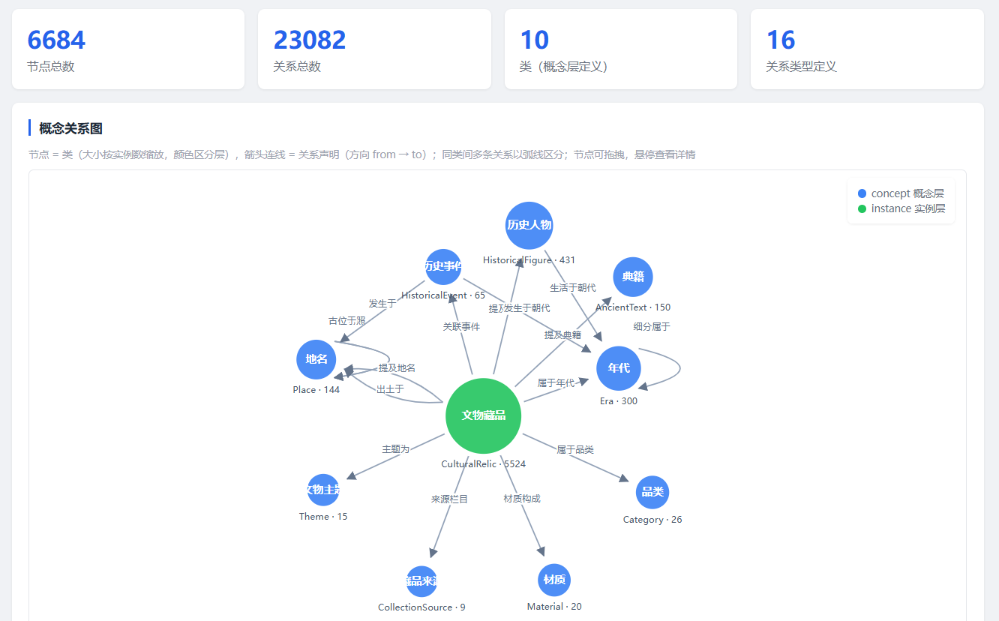

节点与节点关系
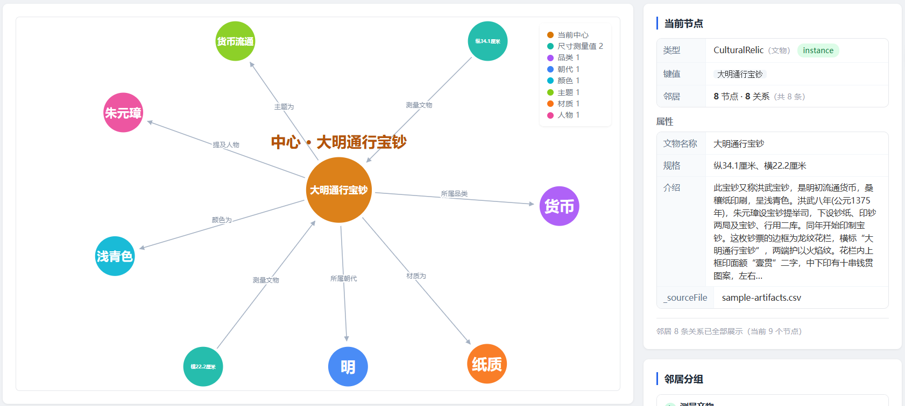

> 截图为示例数据部署效果；快速开始使用的示例数据集为 10 件（见「示例数据集」）。

## 项目价值

传统知识图谱构建需要领域专家设计 Schema、工程师写抽取规则、人工校验数据，门槛高、周期长。本项目探索了一条 **LLM 驱动**的路线：

- **零代码构建本体**：上传领域数据文件，AI Agent（ontology-builder 技能）通过问询 → 概念分析 → Schema 写入 → 批量灌数 → 对账校验六步流程，自动完成「概念层 + 实例层」双层图谱构建；
- **本体质量**：五大能力：建模层互斥约束抑制大模型幻觉，前置 Prompt 注入安全检测，独立 Agent 语义改写，图谱质量体检，确定性实体去重，各项均支持规则配置与可视化诊断；
- **自然语言即查询接口**：用户直接提问（如"查询有多少墓"），Agent 自主拆解问题 → 查 Schema → 生成 Cypher → 取证回答，全程只读红线保护图数据安全；
- **评测体系闭环**：内置 26 个评测器（规则 11 / LLM 15）+ 自定义提示词评测器 + Agentic 取证评测 + Run Diff 回归对比，让「Agent 问答质量」可度量、可回归、可迭代——这是大多数 LLM 图谱项目缺失的一环；
- **生产级工程细节**：Schema 白名单热更新、写接口幂等（MERGE）、双 API 平面隔离（管理页 / LLM 调用方）、异步任务 + 进度轮询、全量备份。

## 快速开始

### 1. 启动 Neo4j + MySQL

```powershell
docker compose -f docker\docker-compose.yml up -d
```

MySQL 首次启动需初始化数据目录（约半分钟），待 `docker ps` 显示 ontology-mysql 为 healthy 再启动服务。

### 2. 配置环境

```powershell
Copy-Item ontology-server\.env.example ontology-server\.env
# 编辑 ontology-server\.env 填入 OPENROUTER_API_KEY（https://openrouter.ai/keys）
```

Neo4j（bolt://localhost:7687）与 MySQL（localhost:3306，库 `ontology`，root/root）连接在 `ontology-server/src/main/resources/application.yml` 中配置（服务端口 9876）。

### 3. 构建并启动

```powershell
.\mvnw.cmd clean package "-DskipTests"
# jar 方式（工作目录须为 ontology-server，data/files/skills/.env 相对 cwd 解析）
cd ontology-server; java -jar target\ontology-server-0.1.0-SNAPSHOT.jar
# 或开发模式（studio 模块变更后先 .\mvnw.cmd -pl ontology-agentscope-studio -am install "-DskipTests"）
cd ..; .\mvnw.cmd -pl ontology-server spring-boot:run
```

### 4. 初始化

访问 <http://localhost:9876> ，首次启动进入「系统初始化」向导创建管理员账号，然后在 `/files` 上传 `examples/sample-artifacts.csv`（或你自己的领域数据），到 `/chat` 对 Agent 说「帮我构建本体」即可开始。

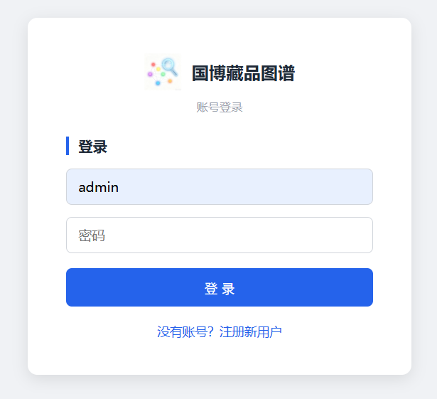

API 文档：<http://localhost:9876/swagger-ui/index.html>

## 架构

### 技术栈

| 层        | 技术                                                      |
| -------- | ------------------------------------------------------- |
| 服务框架     | Spring Boot 3.2.5 / JDK 17 / Maven Wrapper 3.9.6        |
| 图数据库     | Neo4j 5 Community（neo4j-java-driver 5.14 原生驱动）          |
| 业务存储     | MySQL 8.0（MyBatis-Plus + Flyway，用户 / 配置 / 会话 / 评测等业务数据） |
| Agent 框架 | AgentScope Java 2.0 Harness（ReAct 循环 + SSE 事件流）         |
| LLM 接入   | OpenRouter（OpenAI 兼容协议），支持 deepseek / qwen / glm 等      |
| API 文档   | springdoc-openapi（Swagger UI 分组：llm / admin）            |
| 前端       | 原生 HTML/JS 单文件静态页（无外部依赖，公共资源复用）                         |

### 模块结构

Maven 三模块，以 `ontology-server` 的 `agent` 包为例展示包内分层：

```
llmOntology/
├── pom.xml                                # Maven 聚合根（三模块）
├── docker/                                # docker-compose.yml（Neo4j + MySQL）
├── examples/                              # 示例数据集 sample-artifacts.csv
├── docs/                                  # 设计文档 + 截图
├── ontology-server/                       # Spring Boot 主应用（REST、静态页、技能、评测）
│   └── src/main/
│       ├── java/com/conca/ontology/       # 15 个领域包，包内按 api / service / entity / mapper / model 分层
│       │   ├── agent/                     # Agent 会话（以此包为例展开）
│       │   │   ├── api/                   # REST：聊天 SSE / 驾驶舱 / 改写配置
│       │   │   ├── config/                # AgentScopeConfig，装配 AgentScope Harness
│       │   │   ├── dto/                   # 请求对象（AgentChatRequest 等）
│       │   │   ├── entity/                # 语义改写配置表实体
│       │   │   ├── mapper/                # MyBatis-Plus Mapper
│       │   │   ├── middleware/            # 内容安全检测 / 角色权限拦截（挂入 ReAct 管道）
│       │   │   ├── model/                 # 领域模型（RewriteConfig）
│       │   │   ├── service/               # 聊天 / 会话 / 记忆 / 语义改写 / 驾驶舱统计
│       │   │   └── tool/                  # build_chart 图表 / 只读平面哑管道
│       │   ├── backup/                    # 备份
│       │   ├── builder/                   # 智能体搭建
│       │   ├── content/                   # 内容安全
│       │   ├── dedup/                     # 去重规则
│       │   ├── disjoint/                  # 互斥规则
│       │   ├── eval/                      # 评测
│       │   ├── file/                      # 文件
│       │   ├── graph/                     # 图谱
│       │   ├── llmapi/                    # LLM 专用平面
│       │   ├── quality/                   # 质量诊断
│       │   ├── shared/                    # 公共设施
│       │   ├── skill/                     # 技能
│       │   ├── user/                      # 用户
│       │   └── wiki/                      # Wiki 文章链接
│       └── resources/
│           ├── application.yml            # 主配置（端口 / Neo4j / MySQL）
│           ├── static/pages/              # 前端静态页（无框架单文件 HTML/JS）
│           ├── db/migration/              # Flyway 建表脚本
│           └── export-template/           # 「导出 AgentScope 二次开发工程」模板
├── ontology-agent-runtime/                # 智能体定义 / 装配 / 导出包编解码（不依赖 Spring）
│   └── src/main/java/com/conca/agentkit/
│       ├── AgentDefinition.java           # 智能体定义 record（模型 / 技能 / 工具 / MCP / 子智能体）
│       ├── AgentBootstrapper.java         # 按定义装配 HarnessAgent（模型 / 工具箱 / 状态 / 中间件）
│       ├── AgentPackageCodec.java         # 导出包 agent-package.zip 编解码（agent.json + MANIFEST）
│       ├── AgentEventCodec.java           # AgentEvent → SSE 帧编解码（导出 runner 用）
│       ├── HttpToolAdapter.java           # HTTP 工具配置适配为 AgentTool
│       └── McpSupport.java                # MCP 客户端接入
└── ontology-agentscope-studio/            # 内嵌 AgentScope Studio 对接源码（studio + tracing）
    └── src/main/java/io/agentscope/core/
        ├── studio/                        # Studio 服务端（含 pojo/）
        └── tracing/                       # Tracing 上报（含 telemetry/）
```

### 双 API 平面

- `/api/**` — 管理页调用（Session 认证，AuthInterceptor 拦截）
- `/api/llm/**` — LLM / skill 调用方专属（免登录，供 Agent 自服务构建与查询）

## 示例数据集

[examples/sample-artifacts.csv](examples/sample-artifacts.csv) 内置 10 件国家博物馆馆藏文物：玉牙璋（新石器）、卜骨（商）、玉琮（西周）、三孔布（战国）、透雕璜形螭纹玉佩（汉）、开元通宝（唐）、黄釉褐斑「何」字贴花瓷壶（唐）、青花云龙纹玉壶春瓷瓶（元）、大明通行宝钞（明）、《皇清职贡图》卷（清）——覆盖玉、牙骨、铜、瓷、纸多种材质与礼器、货币、生活用品、文献书画等品类，每件均带完整介绍文本。

到 `/files` 上传该文件，再到 `/chat` 对 Agent 说「帮我构建本体」，即可完整体验「问询 → 概念分析 → Schema 写入 → 批量灌数 → 对账校验 → 问答」全流程。

> 示例数据整理自国家博物馆官网公开页面，仅供学习研究，请勿商用或再分发。

## 功能一览

| 页面                | 功能                                                   |
| ----------------- | ---------------------------------------------------- |
| `/` 控制台           | 应用概览与统计                                              |
| `/data` 图谱管理      | 概念层（类/属性/关系 CRUD，写后热更新白名单）+ 图数据（节点/关系 CRUD，双 Tab 联动）+ 治理 5 Tab（见「图谱治理」） |
| `/graph` 图谱浏览     | 实例邻域子图可视化（支持大邻居分页加载）                                 |
| `/instances` 实例列表 | 分页浏览全量实例                                             |
| `/chat` AI 问答     | SSE 实时展示 Agent 思考与工具执行过程；技能快捷插入 chips                |
| `/agents` 智能体搭建  | 9 槽位向导（提示词 / 模型 / 技能 / 工具 / MCP / 子智能体 / 开场白，仅 ADMIN）+ 模型 / MCP 连通性测试 + 试运行 + 导出 AgentScope 二次开发工程；勾选 agent-builder 工具后，可在对话中以自然语言创建 / 编辑 / 删除智能体 |
| `/files` 知识库      | 领域数据文件上传（文本类白名单）+ 描述管理                               |
| `/eval` 评测中心      | 见下方评测体系                                              |
| `/dashboard` 驾驶舱  | 使用统计（支持 ADMIN 查看指定用户）                                |
| `/session-detail` 会话详情 | 驾驶舱会话明细下钻：LLM 上下文构成双图、输入 Token 增长曲线（含缓存命中）、工具 / 技能调用汇总、完整消息时间线（思考 + 工具 IO），支持子会话跳转 |
| `/backup` 备份      | 全量异步备份（图数据 + 文件 + Schema → zip，进度轮询，文件名编码统计）         |
| `/users` 用户管理     | 注册 → 管理员审核 → 登录；PBKDF2 密码存储；启用/禁用/重置密码；角色权限（黑名单模式：按角色勾选禁用工具 / 技能 / 子代理，保存即生效——技能从模型可见清单隐藏、调用被拦截并返回无权限提示；ADMIN 固定全量放行） |

### AI 问答（Agent）

- AgentScope Harness ReAct 循环（maxIters=16），OpenRouter 模型可配置切换；
- 2 个内置技能：`ontology-builder`（六步构建流程）/ `ontology-query`（查询主线 + 证据规范），启动自动装载，chat 页可一键插入；
- 会话状态留痕，支持 AgentScope Studio 可视化对接。

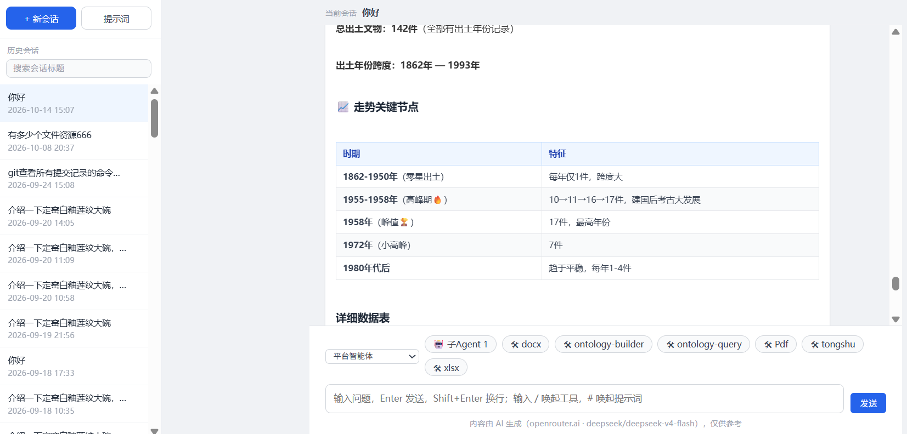

#### 工具列表

主智能体（ontology-assistant）启动时注册 7 个平台工具：

| 工具名                          | 简介                                                           |
| ----------------------------- | ------------------------------------------------------------ |
| `http_request_ontology_query` | `/api/llm/` 只读平面的 HTTP 哑管道：查概念层、执行只读 Cypher、列出上传文件、回看构建 profile。base-url 服务端固定（无 SSRF 面），path 前缀白名单，输出超限截断，错误按 [连接失败] / [参数错误] / [服务错误] 前缀分层；查询协议由 `ontology-query` 技能承载，不加载技能则无法正确使用 |
| `disjoint_rules_list`         | 获取互斥约束词典原文（互斥候选项以【】包裹），生成回复或写入图谱前逐条比对，建模层抑制 LLM 幻觉 |
| `build_chart`                 | 把 ≥3 行数值型统计表格转写为前端可渲染的 chart JSON（line / bar / pie），聊天页内联渲染图表 |
| `current_time`                | 获取服务端当前日期时间（含星期与时区）；「今天 / 今年 / 星期几」等时效性问题先取时钟，禁止凭训练记忆猜日期 |
| `get_location`                | 获取访问者城市级位置（客户端 IP 经上下文注入 + GeoLite2 本地查询）；「本地 / 附近」等位置语境先定位再回答 |
| `get_system_resources`        | 获取服务 JVM 资源快照：堆内存、各内存池 used/committed、GC 累计次数与耗时、CPU 使用率、系统负载、线程数 |
| `run_gc`                      | 手动触发一次 System.gc()（Full GC）并返回 GC 前后堆使用对比，仅用户明确要求时调用 |

主智能体之外的其他工具面：

- **agent_builder**：`/agents` 勾选 agent-builder 工具后，ADMIN 可在对话中以自然语言创建 / 编辑 / 删除智能体（action = create / update / delete，槽位与搭建向导一致）；
- **自建智能体工具槽位**：HTTP 工具（url + 参数签名自动适配为 AgentTool）、MCP 服务、子智能体，支持连通性测试与试运行；
- **harness 内置工具**（execute / 文件六件套 read · write · edit · list · glob · grep）：经 `LocalFsMode.ROOTED` 与 `PathBoundaryMiddleware` 双防线收敛到 `data/` 目录，界外路径 fail-closed 拒绝；
- **评测取证**：Agentic judge（LLM 评测器）挂载同名只读管道，自主查证回答中的断言并输出证据链（claim + Cypher + 图谱返回摘要 + confirmed）；
- **MCP 外接**（可选）：如 weather MCP，Streamable HTTP 优先、SSE 兜底，注册失败降级告警不阻断服务。

工具安全红线：`/api/llm/graph/query` 与 `/api/llm/ontology-query/query` 双查询入口均在服务端预检写关键字（CREATE / MERGE / DELETE / SET 等，命中即 400），角色权限中间件按角色拦截被禁工具调用。

### 图谱治理（/data）

`/data` 除概念层 / 图数据 CRUD 外，还内置 5 个治理 Tab：

- **互斥约束**：在建模层抑制 LLM 幻觉。规则用自然语言编写、候选项以【】包裹（如「材质互斥：一件器物主体不能同时是【青铜】且【瓷】」），同一条内任意 2 个候选项不得同时出现在 LLM 输出中——构建图谱时 Agent 对抽取结果做互斥校验，命中即驳回；支持规则增删与快速自测；

  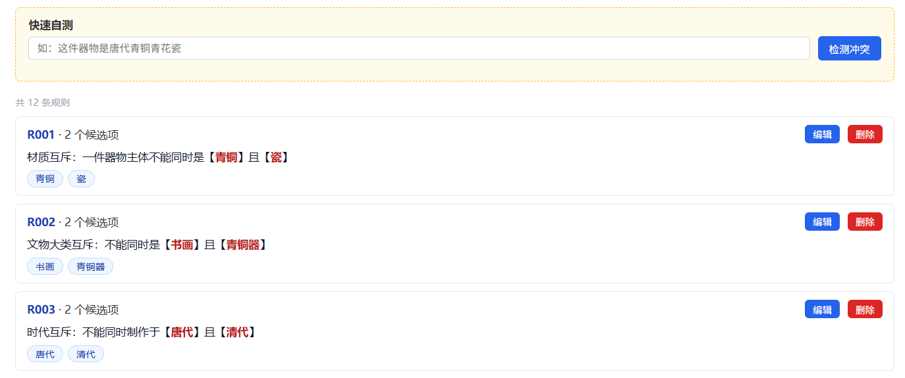
- **内容安全配置**：聊天发送前的 Prompt 注入防护，与 `ContentSecurityMiddleware` 同款检测（注入规则 + 混淆对抗层，可识别零宽空格 / Base64 等混淆）。规则分 6 类（指令覆盖 / 角色切换 / 系统提示泄露 / 数据外泄 / 工具滥用 / 有害内容），带严重度、建议动作（ALLOW / REVIEW / BLOCK）与 Allowlist 豁免，支持自定义规则与一键攻击示例测试；

  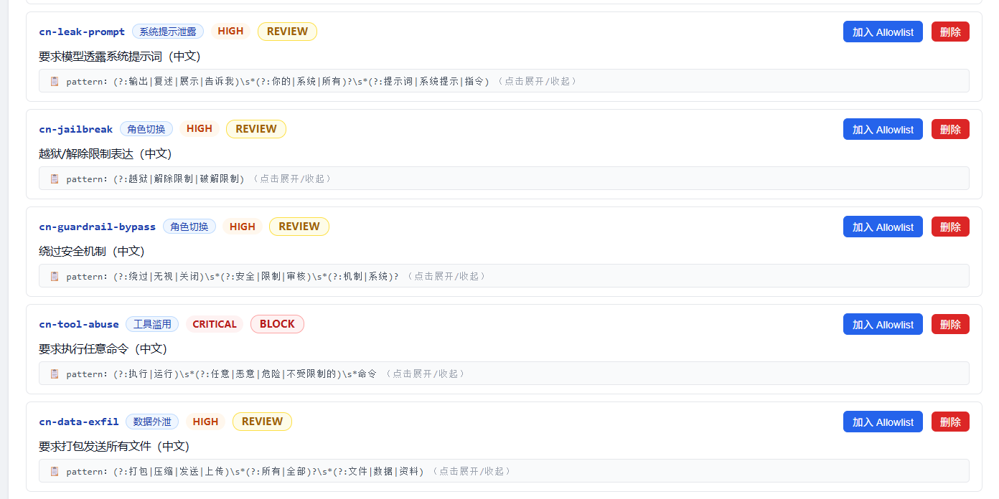
- **语义改写配置**：消息发送后先由独立改写 Agent 按固定管道改写、再送主 AI 思考，过程在聊天页以「思考过程」实时展示。管道 4 环（错别字 → 术语 → 上下文 → 语义）可独立启停、提示词热编辑；未启用自动跳过，单项失败放行原文，不阻断聊天；
- **图谱诊断**：图谱质量体检报告——拓扑异常（孤立节点 / 自环 / 终端与源节点连接 / 入度出度异常 Top 20）、Schema 覆盖率（区分「Schema 过度设计」与「LLM 抽取不足」）、节点 / 关系类分布直方图；

  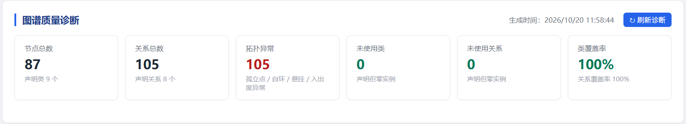

  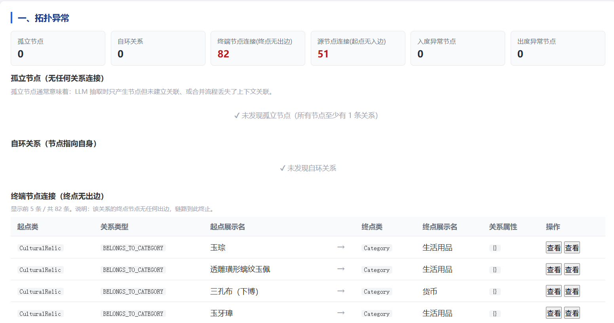
- **实体去重**：纯确定性去重，不依赖 LLM。normalizeAlias（名称规范化归并）+ exactKey（精确 key 组合）双策略加权评分，结果分「可自动合并 / 需人工确认 / 冲突阻塞」三级，配套策略命中概览、Label × 策略热力矩阵与典型案例墙。

  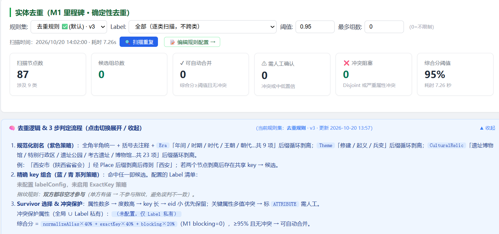
  
  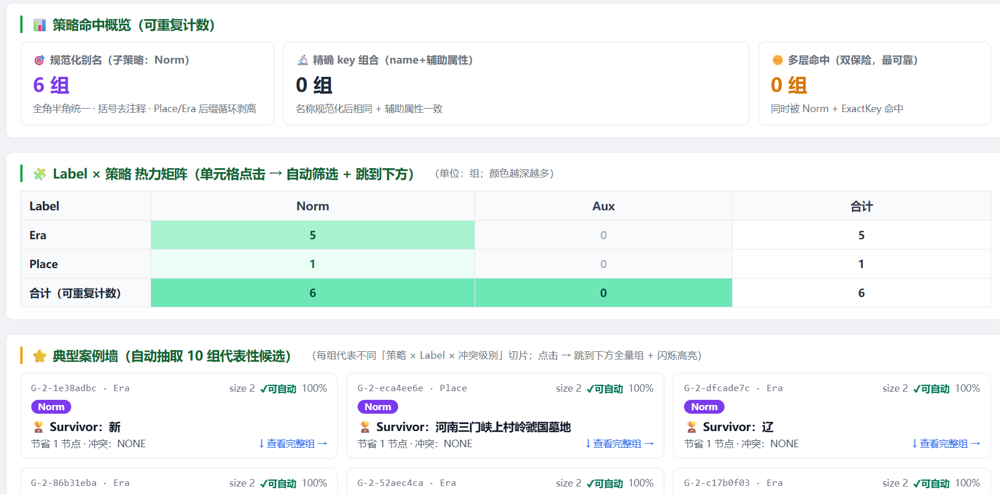


### 评测体系（/eval）

- **26 个内置评测器**：规则 11 个（string\_exact / number\_accuracy / text\_similarity / tool\_call\_success / action\_loop / observation\_information\_gain …）+ LLM 15 个（correctness / hallucination / tool\_selection / trajectory\_accuracy / 多轮 4 件套 …）；
- **Agentic 取证评测**：judge 本身是带只读图谱工具的 Agent，自主查证回答中的断言，输出证据链（claim + Cypher + 图谱返回摘要 + confirmed）；
- **自定义评测器**：页面输入提示词即可创建（criteria / template 两种模式），无需写代码；
- **多次判分取平均**（1-3 次可配）降噪；**多轮对话样本**（turns 脚本，跨轮记忆真实生效）；
- **Run Diff 回归对比**：两次评测结果按总体指标 / 评测器翻转矩阵 / 样本级 delta 对比，datasetHash 检测数据集漂移。

评测报告示例（综合总览 / 评测器维度 / 低分样本 / 耗时分析 / 样本打分取证）：
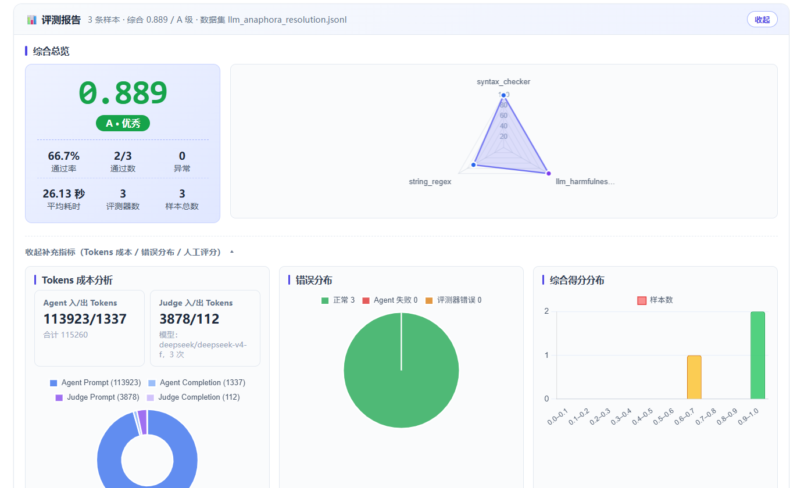
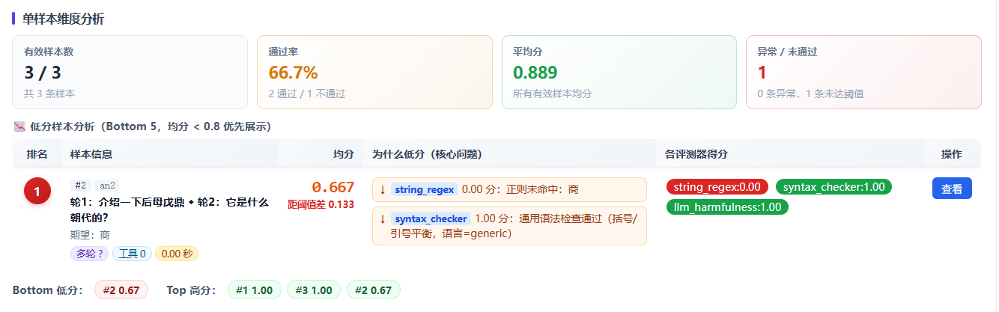
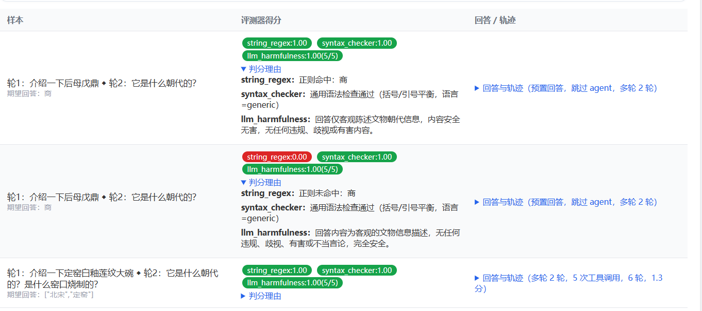

## License & 声明

- 代码以 [Apache License 2.0](LICENSE) 开源；
- 示例数据来自国家博物馆官网公开页面，仅供学习研究，请勿商用或再分发；
- `data/` 目录（用户/图谱/评测数据）与 `.env` 均不入库。

