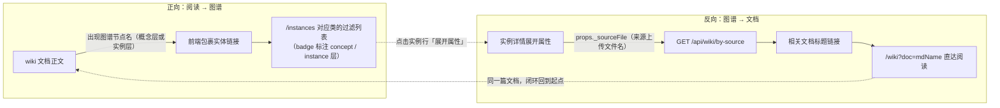
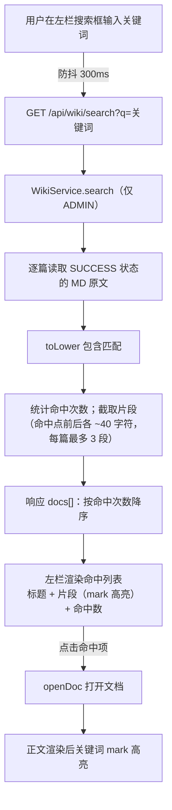
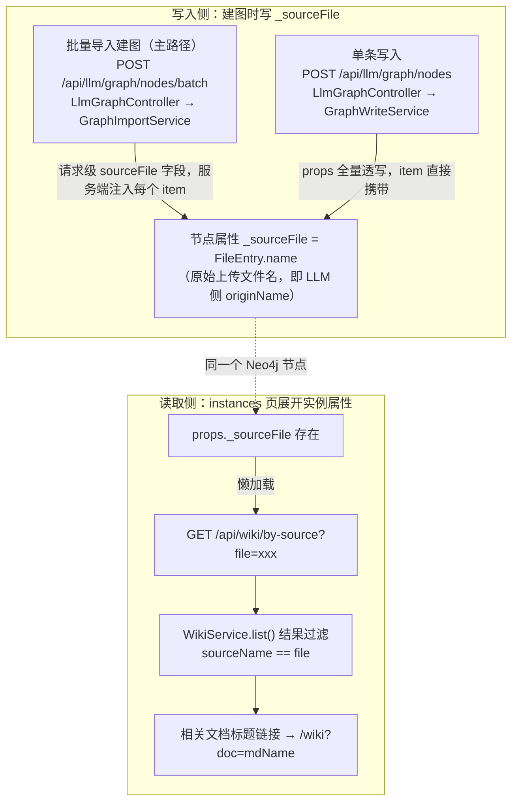
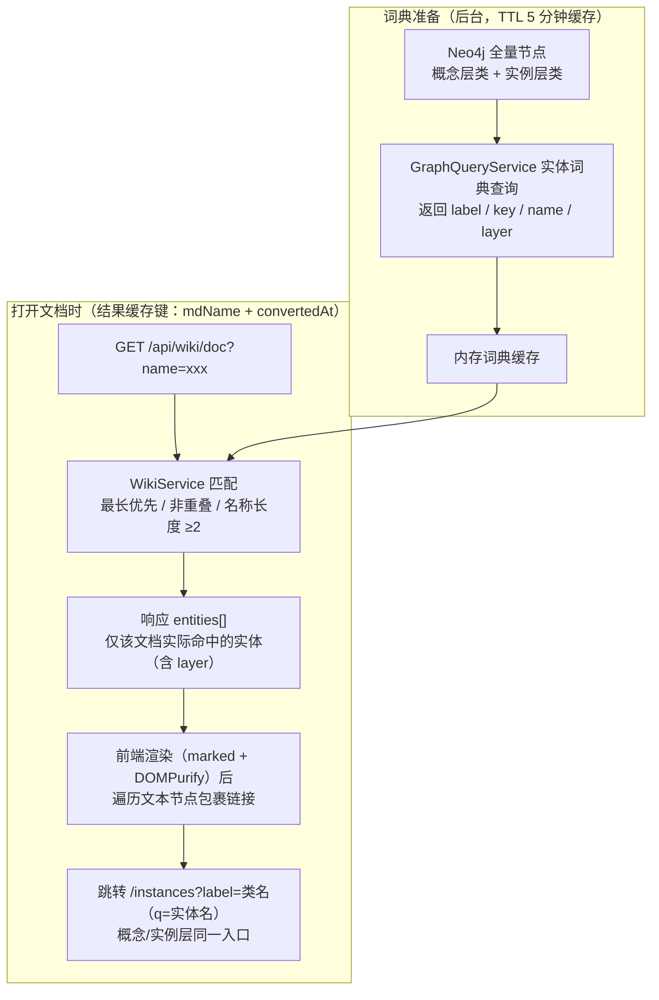

# Wiki 知识库 P1 设计方案：全文搜索 + 图谱联动

> 版本：v1.2（2026-09-30：融入 WeKnora Wiki 实现借鉴——①搜索字段加权排序与结果上限；②实体匹配 ASCII 词边界；③§4.0 写入侧勘误（GraphImportService 批量路径 + originName 值规范）；④新增附录 A 采纳/不采纳清单）
> v1.1（2026-09-23：v1 评审修订——①实体词典明确覆盖概念层+实例层两类节点；②关键数据流转处补充 mermaid 流程图）
> 前置：P0 已上线（`/wiki` 页面、`/api/wiki` 列表/单篇/元信息编辑、`data/wiki-metadata.json`）
> 范围：只做设计，不含实现代码

## 1. 背景与目标

P0 已实现只读呈现层（列表/阅读/TOC/元信息）。P1 补齐"发现"与"联动"两块：

1. **全文搜索**：搜索范围从"标题/元信息"扩展到 MD 正文，返回命中片段
2. **图谱联动**：形成"文档 ↔ 图谱"双向闭环
   - 正向：wiki 阅读时，正文中匹配到图谱节点名（**概念层概念实例 + 实例层实体**）的文本自动加链接，跳转 `/instances`
   - 反向：实例详情展开"相关文档"，复用 `_sourceFile` 溯源字段回链 wiki 文档

闭环总览（正向怎么跳到图谱、反向怎么跳回文档）：

## 2. 现状盘点（P1 依赖的既有设施）

| 设施 | 现状 | 说明 |
|---|---|---|
| wiki P0 | ✅ 已上线 | `WikiService`：SUCCESS 过滤 + 元信息抽取 + wiki-metadata.json |
| 实例查询 | ✅ 已有 | `GraphQueryService.nodesPage(label, page, size, q)`：q 为全属性 toLower CONTAINS；`GraphSchema.keyPropOf(label)` 提供各类 keyProp |
| instances 页 URL 约定 | ✅ 已有 | `/instances?label=<类>&page=1&q=<关键词>`；实例名显示取 `props.title ?? props.name ?? props.cnName`，兜底 key；页面标题 `badge(cls.layer)` 标注概念层/实例层，**两类节点同一入口** |
| **`_sourceFile` 溯源字段** | ❌ **未实现** | 此前规划的 P0 溯源注入（GraphWriteService 重载 + LlmGraphController 透传 + GraphImportController 自动填充）尚未落地，当前代码库 grep 无 `_sourceFile`。**反向相关文档依赖它，须作为 P1 前置** |

## 3. 功能一：全文搜索

数据流（从用户输入到命中展示）：

### 3.1 API 设计

`GET /api/wiki/search?q=<关键词>`（仅 ADMIN，复用 `/api/wiki` 前缀拦截）

响应结构（新增 result DTO `WikiSearchResult`）：

| 字段 | 说明 |
|---|---|
| `q` | 回显关键词 |
| `docs[]` | 命中文档列表，按加权分降序（标题/元信息命中优先于正文命中次数，见实现要点；同分按命中次数） |
| `docs[].mdName / title / publishDate / source / category / tags` | 同 WikiDocView 关键字段 |
| `docs[].hits` | 该文档命中总次数 |
| `docs[].snippets[]` | 命中片段，每篇最多 3 个：`{text}`（命中词前后各约 40 字符，原文截取） |

实现要点（WikiService 新增 `search(q)`）：
- 逐篇读取 MD（与 list() 同源，仅 SUCCESS 条目），`toLower` 包含匹配
- 排序采用**字段加权**（借鉴 WeKnora 搜索的字段优先级 title > summary > content）：加权分 = 标题命中 ×40 + 元信息（来源/分类/标签）命中 ×20 + 正文每次命中 ×1，按加权分降序——标题命中的文档始终排在纯正文命中之前
- 响应防御上限：`docs[]` 最多 50 篇（WeKnora 搜索同为 limit 50；当前规模实际不会触顶）
- 片段截取：以命中位置为中心前后各 ~40 字符，多个命中位置相距 < 40 字符合并为一个片段
- 空白关键词或长度 < 1 → 返回空列表（400 无必要，直接空）
- 规模评估：当前 4 篇 / 目标百篇内，内存直接扫描毫秒级，**不做倒排索引**；预留内容缓存（mdName → content，convertedAt 失效）作为后续优化点，P1 不实现

### 3.2 前端交互（wiki.html）

搜索框行为统一（保持单输入框）：

| 输入状态 | 行为 |
|---|---|
| 空 | 现状不变：左栏全量列表（本地渲染） |
| 有输入 | 防抖 300ms 调 `/api/wiki/search`，左栏渲染命中列表：标题 + 命中片段（关键词用 `<mark>` 高亮，片段经 esc 转义后拼接，防 XSS）+ 命中次数 |
| 点击命中项 | `openDoc(mdName)` 打开文档；打开后正文中该关键词同样以 `<mark>` 高亮（复用 DOMPurify 渲染后的文本节点遍历，或渲染前对 MD 关键词包裹 mark——选后者更简单，注意避开代码块） |
| 清空输入 | 恢复本地列表过滤（P0 逻辑保留） |

## 4. 功能二：图谱联动

### 4.0 前置任务：`_sourceFile` 溯源注入（最小集）

反向"相关文档"依赖实例节点上的 `_sourceFile` 属性，需先落地此前规划的溯源注入最小子集。

`_sourceFile` 全生命周期数据流（谁写入、存在哪、谁读取）：

说明：`_sourceFile` 存的是**原始上传文件名**（`FileEntry.name`），wiki 文档的 `sourceName` 同样来自 `FileEntry.name`——两侧天然同源，反向匹配即字符串相等。

具体改动点：

- **GraphImportService**（批量导入主路径，`POST /api/llm/graph/nodes/batch`）：NodeBatchRequest 增加可选 `sourceFile` 批次字段，服务端注入每个 item——批次级填充比 LLM 逐条携带更可靠
- **GraphWriteService**（单条写入）：现有实现 `SET n += $props` 已全量透写属性（无属性名白名单），LLM 在节点 props 里直接带 `_sourceFile` 即可落库，**无需改造**
- **LlmGraphController**（LLM 建图 HTTP 平面，供执行 ontology-builder skill 的 LLM 调用）：文件名经 `GET /api/llm/files` 进入 LLM 上下文；**注意转换成功文件的 `name` 字段是 mdName（如 `报告.docx.md`），原始文件名在 `originName` 字段**——透传必须取 `originName`，否则反向匹配全部落空
- 管理页手工建点（`/api/graph`，data.html）无来源文件概念，不注入
- 其余溯源字段（`_sourceChunk/_sourceSpan/_extractedBy/_extractedAt/_confidence`）**不在 P1 范围**，仍按原规划独立排期
- 值规范：统一存 `FileEntry.name`（原始上传文件名，含子目录相对路径，即 LLM 侧 `originName`），与 wiki 文档的 `sourceName` 同源，反向匹配即字符串相等；文件改名/重传会使两侧断链，P1 接受，对账提示列附录 A.3
- **存量实例无 `_sourceFile`**：反向"相关文档"为空即可接受；已确认不做批量回填（见 §8 决策点 3）

### 4.1 正向：正文实体自动链接

数据流（词典怎么来、匹配在哪做、链接怎么生成）：

**实体词典**：
- 数据来源：**全量图谱节点，同时覆盖概念层（layer=concept）与实例层（layer=instance）两类节点**——正文中"商代""青铜"等概念实例名与"三星堆遗址"等实例名同样成链
- 名称取值与 instances 页一致：`props.title ?? props.name ?? props.cnName ?? key`
- 新增内部查询：GraphQueryService 提供实体词典方法（单条 Cypher 扫描**全部类**，返回 label/key/name/layer 四元组列表）
- 词典缓存：内存缓存 + TTL（建议 5 分钟）；节点增删后最多延迟一个 TTL 生效，可接受

**匹配策略（后端预筛）**：
- `GET /api/wiki/doc` 响应扩展 `entities[]`：`{name, label, key, layer, count}`——仅返回**该文档正文实际命中**的实体
- 后端匹配在 MD 原文上进行：
  - 词典按名称长度**降序**逐一 `contains` 检测，**最长优先、已命中区间不重叠**（避免"三星堆遗址"被"三星堆"截断）
  - 名称长度 ≥ 2 才参与匹配（单字实体误命中率高，跳过）
  - 大小写不敏感（中文为主，英文场景 toLower）
  - 纯 ASCII 名称须**词边界匹配**：命中位置前后不能是字母/数字（如实体 `Era` 不得命中 `generated` 内部）——借鉴 WeKnora linkify 的 ASCII 词边界校验，防英文子串误链
- 文档级结果缓存：key = `mdName + convertedAt`（重转后自动失效），词典缓存失效时一并失效

**前端包裹（wiki.html renderDoc 增强）**：
- 渲染（marked + DOMPurify）完成后，遍历 `#wk-body` 的**文本节点**做包裹：
  - 仅处理不在 `<a>`、`<code>`、`<pre>`、标题（h1-h3，避免与 TOC 锚点/链接嵌套冲突）内的文本
  - 命中实体名替换为链接：`/instances?label=<label>&page=1&q=<name>`（复用 instances 页现有 URL 约定，q 为 CONTAINS 模糊匹配，落地即相关实例列表；**概念层与实例层节点同一入口**，页面 badge 区分）
  - 链接样式加下划线虚线或浅色底，与正文普通 `<a>` 区分；**按 layer 区分视觉**：概念层蓝 #3b82f6、实例层绿 #22c55e（与 index.html 概念关系图配色一致），悬停提示"查看图谱实例（概念层/实例层）"
- 前端只负责"包裹"命中的有限实体集合（后端已筛），不加载全量词典，避免大传输与前端匹配开销

### 4.2 反向：实例详情"相关文档"

**API**：`GET /api/wiki/by-source?file=<sourceName>`（仅 ADMIN）

- 实现：WikiService.list() 结果按 `sourceName == file` 过滤，返回 `{docs: [WikiDocView...]}`
- 匹配语义：字符串相等（两侧均源自 `FileEntry.name`，天然对齐）

**前端（instances.html）**：
- 实例行展开属性区（detail-row）末尾追加"相关文档"块：
  - 前置条件：`props._sourceFile` 存在
  - 展开时懒加载调 by-source 接口，渲染文档标题链接 → `/wiki?doc=<mdName>`（wiki 页已支持 `?doc=` 直达）
  - 无 `_sourceFile`、或查询无结果 → 不渲染该块（不显示空区块）
- **可见性决策**（见 §8 决策点）：默认方案——`/api/wiki/by-source` 与 wiki 整体一致仅 ADMIN；instances 页普通用户不请求该接口、"相关文档"块仅对 ADMIN 渲染（`CF.initUser` 已提供角色）

### 4.3 闭环验收路径

1. 正向：打开"三星堆陨铁器"文档 → 正文中实例名（如"三星堆遗址"，绿色链接）与概念名（如"商代"“青铜”，蓝色链接）均成链 → 点击 → `/instances?label=…&q=名称` 列表（badge 标注所属层）
2. 反向：该列表实例（有 `_sourceFile`）展开属性 → "相关文档"显示来源文档 → 点击 → `/wiki?doc=…` 回到阅读
3. 全文搜索：输入"陨铁" → 命中片段列表 → 打开文档正文高亮

## 5. 权限与安全

| 入口 | 权限 | 说明 |
|---|---|---|
| `GET /api/wiki/search` | 仅 ADMIN | 复用 `/api/wiki` 前缀 admin-only 拦截，无需改 AuthInterceptor |
| `GET /api/wiki/doc`（响应扩展 entities） | 仅 ADMIN | 同上 |
| `GET /api/wiki/by-source` | 仅 ADMIN | 同上；instances 页对该接口的调用按角色门控（决策点 §8） |
| 实体词典查询 | 服务层内部 | 不暴露 HTTP 端点（避免全量实例数据导出接口） |

安全注意：
- 搜索片段、实体名、文档标题一律经 `esc()` 后拼接 HTML；`<mark>` 与实体链接在 DOMPurify 渲染**之后**的文本节点上包裹，不引入新 XSS 面
- 词典查询为服务层只读 Cypher（单条 MATCH，无参数拼接风险）

## 6. 性能设计

| 项 | 量级 | 策略 |
|---|---|---|
| 全文搜索 | ≤ 数百篇 × ≤ 200KB | 内存扫描，单次毫秒级；不建索引 |
| 实体词典 | 千级实例名 | 内存缓存 + TTL 5 分钟 |
| 单篇实体匹配 | 千级名称 × 百 KB 文本 | 结果缓存（mdName + convertedAt 失效）；词典变更随 TTL 失效 |
| 前端包裹 | 单篇命中实体数（≤ 百级） | 文本节点一次遍历，无感知延迟 |

## 7. 实施顺序（建议）

| 步骤 | 内容 | 依赖 |
|---|---|---|
| 1 | 全文搜索（后端 search + 前端搜索框升级 + 正文高亮） | 无 |
| 2 | 前置：`_sourceFile` 溯源注入最小集（GraphImportService 批次字段 + SKILL.md 补"透传取 originName"说明） | 无 |
| 3 | 正向：实体词典查询 + doc 响应 entities + 前端包裹链接 | 无（与 2 无依赖） |
| 4 | 反向：by-source 接口 + instances.html 相关文档块 | 步骤 2 |

## 8. 决策点（已确认 2026-09-23）

1. **反向"相关文档"可见性**：仅 ADMIN（与 wiki 整体权限一致；instances 页普通用户不请求 by-source 接口、不渲染该块）。
2. **`_sourceFile` 溯源注入**：纳入 P1 作为前置任务（实施顺序步骤 2），最小集仅 `_sourceFile` 一个字段。
3. **存量实例回填**：不做。存量实例无 `_sourceFile` 则反向不显示"相关文档"，新建图自动携带。

## 9. 验收标准

- 搜索：任意正文关键词 1s 内返回命中列表，片段正确高亮且无 XSS；标题/元信息命中的文档排在纯正文命中之前；空/短关键词不报错
- 正向：含图谱节点的文档打开后实体名呈链接态；**概念层节点名（如年代、材质类受控词）与实例层节点名均可成链且视觉可区分**；点击落到 `/instances` 对应过滤列表；`<code>`/`<a>`/标题内不误链
- 反向：带 `_sourceFile` 的实例展开可见"相关文档"，点击直达 wiki 文档；无溯源字段实例无该区块
- 缓存：实例增删后 ≤ 5 分钟词典生效；MD 重转后实体匹配结果自动失效重算
- 权限：非 ADMIN 访问三个新/扩展接口均 403

## 附录 A：WeKnora Wiki 实现借鉴（2026-09-30）

> 对照分析见 `C:\me\kaiyuan\agenttrace\WeKnora-Wiki实现分析.md`（代码库 WeKnora-main，腾讯开源）。WeKnora 是"LLM 摄取管道生成页面 + 双向链接 + 图谱浏览"的重量级形态（4 万页级 KB）；本项目是"上传文档 MD 呈现 + Neo4j 图谱联动"的轻量形态（百篇内）。按"取思想不取体量"原则筛选如下。

### A.1 已采纳（融入正文）

| 借鉴点 | WeKnora 出处 | 本设计落点 |
|---|---|---|
| 搜索字段优先级排序（title=4 > slug=3 > summary=2 > content=1） | 分析文档 §8 SearchAcross（纯 SQL 加权） | §3.1：标题 ×40 / 元信息 ×20 / 正文单次 ×1，加权分降序（简化版） |
| 搜索结果上限 50 | 分析文档 §8 搜索 limit 上限 50 | §3.1：`docs[]` 上限 50 篇（防御性，当前规模不会触顶） |
| 实体链接 ASCII 词边界校验（防英文子串误命中） | 分析文档 §6 linkifyContent | §4.1：纯 ASCII 名称命中位置前后须非字母/数字 |
| 引用存稳定标识、防文件名幻觉 | source_refs 存裸 knowledge ID 而非文件名/标题 | §4.0：明确 LLM 侧须取 `originName` 而非 mdName；改名断链风险记录在案（A.3） |

### A.2 明确不采纳（形态/规模不符）

| WeKnora 机制 | 不采纳原因 |
|---|---|
| LLM 摄取管道（候选提取 / chunk 引用标注 / Summary 页 / "COMPILER not writer" prompt / 断点续写） | 本项目 wiki 为用户上传原文呈现，无 LLM 生成内容场景 |
| `[[slug]]` 双向链接 + in/out_links + wiki 内图谱浏览 | 图谱主体是 Neo4j（graph.html），联动走 /instances 与 by-source 闭环，不在 wiki 内部再造链接图 |
| 版本快照 + 乐观锁 + 回滚（两级保留策略） | wiki 正文只读，唯一写入口是元信息编辑，风险低；需要时列 P2 |
| 并发工程（per-slug 锁 / per-KB inflight 上限 / 限流退避 / 崩溃恢复） | 百篇内单机规模，无并发摄取场景 |
| Taxonomy 整批目录规划（LLM 分配文件夹） | 目录即 wiki-metadata.json 手工分类，无 LLM 参与 |

### A.3 P2+ 候选（备查，不进 P1 范围）

- **别名参与实体匹配**：WeKnora 将 aliases 作为判重与链接匹配的一等公民；若图节点将来增加别名属性（如"三星堆 / 三星堆遗址"），实体词典可纳入以减少漏链
- **质量 lint**：WeKnora 定期检测孤儿页 / 断链 / 过期引用；对应本项目可做"`_sourceFile` 指向不存在 wiki 文档"的对账检测（by-source 反向验证）
- **源文件改名/删除联动**：WeKnora 文档删除时按 source_refs 回缩页面；本项目文件重传/改名会断链 `_sourceFile ↔ sourceName`，P2 可加对账提示或改名迁移
- **聊天检索加权**：WeKnora 对 chat 命中 wiki 页分数 ×1.3 稳定重排；chat.html 集成图谱/wiki 检索时可参考
